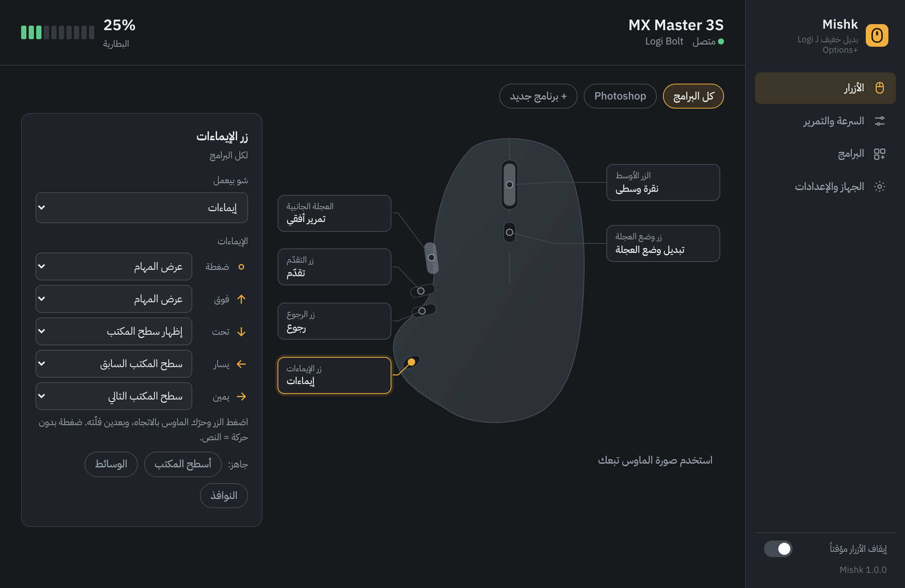
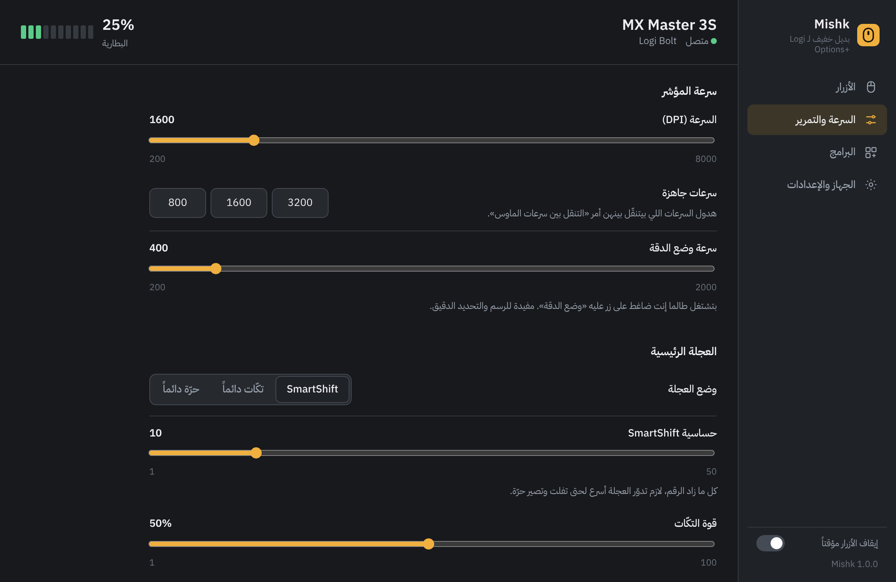
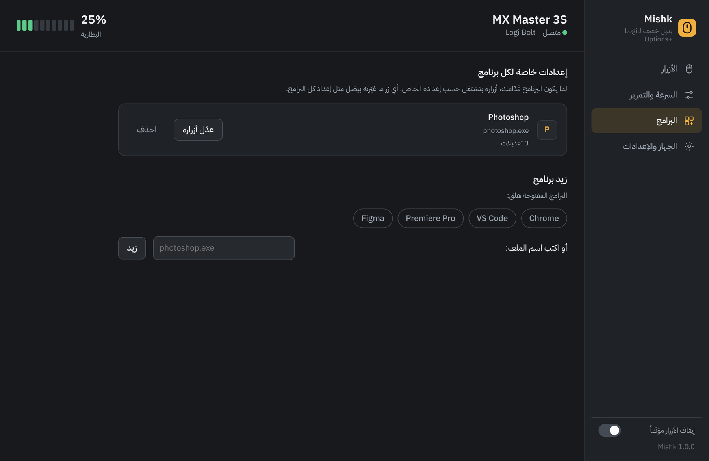
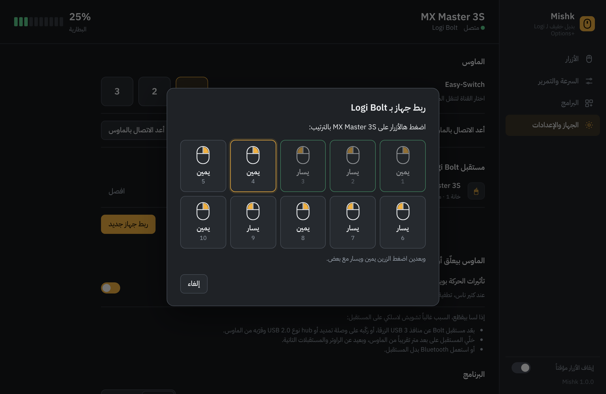

<div align="center" dir="rtl">


# مشك — Mishk

**بديل صغير وسريع لـ Logi Options+ على ويندوز والماك**

معمول لـ MX Master 3S، وبيشتغل مع أغلب الماوسات: ماوسات لوجيتك التانية، وأزرار الرجوع والتقدّم والزر الأوسط لأي ماوس من أي شركة.

**الموقع:** [dlwjan11-dot.github.io/Mishk](https://dlwjan11-dot.github.io/Mishk/)

[English](README.md) · العربية

[**نزّل لويندوز**](https://github.com/dlwjan11-dot/Mishk/raw/main/download/Mishk-Windows.zip) · [**نزّل للماك**](https://github.com/dlwjan11-dot/Mishk/raw/main/download/Mishk-macOS.zip)

</div>



<div dir="rtl">

## ليش؟

برنامج Logi Options+ تقيل، وبيعلّق، وأحياناً بيختفي من الـ tray. أما Mishk فهو برنامج صغير، بدون تنصيب وبدون حساب، لويندوز والماك. بيفتح فوراً، ولما تسكّر النافذة بيرجع للـ tray وبيفضّي الذاكرة.

البرنامج بيحكي مع الماوس مباشرة عن طريق بروتوكول HID++ تبع لوجيتك. الماوس نفسه هو اللي بيخبّر عن ضغطات الأزرار، فما في hook بالويندوز ممكن يوقف فجأة ويخلي الأزرار ما تشتغل.

## شو بيعمل

**الأزرار**
- بتغيّر وظيفة زر الإيماءات، الرجوع، التقدّم، الزر الأوسط، وزر وضع العجلة
- زر الإيماءات: ضغطة، أو سحبة لفوق أو تحت أو يمين أو يسار، وكل وحدة إلها أمر
- أكتر من 60 أمر: ويندوز (عرض المهام، أسطح المكتب، تثبيت النوافذ)، تحرير، متصفح، وسائط، نقرات ماوس، اختصارات كيبورد، فتح برنامج أو رابط
- اختصارات بتضل مضغوطة طالما إنت ضاغط على الزر، مثلاً Space للـ Hand tool بفوتوشوب
- وضع الدقة: بتضغط الزر فبيبطّئ المؤشر، وبتفلته فبترجع السرعة

**إعدادات لكل برنامج**
- أزرار وعجلة جانبية مختلفة لكل برنامج (فوتوشوب، بريمير، كروم…)، وبتتبدّل لحالها لما يكون البرنامج قدّامك
- بتختار من البرامج المفتوحة هلق، أو بتكتب اسم الملف

**العجلة الجانبية**
- تمرير أفقي، زوم، حجم الفرشاة، الصوت، التبويبات، تراجع وإعادة، أسهم للتايملاين، أسطح المكتب، أو اختصارين مخصصين

**المؤشر والتمرير**
- سرعة المؤشر (DPI) مع سرعات جاهزة، وأمر بيتنقّل بيناتهن
- SmartShift، أو تكّات دائماً، أو عجلة حرّة دائماً، مع الحساسية وقوة التكّات
- تمرير ناعم، وعكس اتجاه التمرير للعجلة الرئيسية والجانبية

**ماوسات تانية**
- ماوسات لوجيتك التانية: MX Master 4 (لوحة اللمس كزر إيماءات)، MX Master 2S، MX Anywhere، وMX Vertical (زر السرعة)، وغيرها: الأزرار الموجودة فيها، السرعة، والبطارية
- أي ماوس من أي شركة: الرجوع والتقدّم والزر الأوسط مع الإيماءات وإعدادات لكل برنامج، وسرعة المؤشر بويندوز، والتسارع، وعدد أسطر التمرير

**الربط والجهاز**
- ربط لأول مرة مع مستقبلات Logi Bolt وUnifying، مع أزرار يمين ويسار للتأكيد بـ Bolt، وفصل الأجهزة
- البطارية بالـ tray مع تنبيه لما تضعف
- قنوات Easy-Switch
- الإعدادات بترجع لحالها لما يصحى الماوس أو يرجع يتصل
- مساعد "الماوس بيعلّق؟": بيطفي تأثيرات الحركة بويندوز بكبسة وحدة (بتوقف التقطيع عند كتير ناس على ويندوز 11)، ونصايح لمكان المستقبل

**البرنامج**
- واجهة عربي وإنجليزي، غامق وفاتح
- فيك تحط صورة ماوسك: البرنامج بيشيل الخلفية وبيحط النقاط على الأزرار لحاله
- بيشتغل مع ويندوز، تصدير واستيراد الإعدادات، وسجل لتشخيص المشاكل

</div>

| السرعة والتمرير | البرامج | الربط |
|---|---|---|
|  |  |  |

<div dir="rtl">

## طريقة التشغيل

**ويندوز**


1. سكّر Logi Options+ وشيله من بدء التشغيل، لأن البرنامجين بيتضاربوا على الماوس. Mishk بينبهك إذا لقاه شغّال، وفيه زر بيسكّره.
2. [نزّل Mishk-Windows.zip](https://github.com/dlwjan11-dot/Mishk/raw/main/download/Mishk-Windows.zip)، وكبسة يمين عليه ← **Extract All**، وبعدين شغّل `Mishk.exe`.
3. إذا طلعلك تحذير SmartScreen لأن البرنامج مش موقّع، اضغط **More info** وبعدين **Run anyway**.

البرنامج بيحط حاله بالـ tray وبيشتغل مع ويندوز. الإعدادات بتنحفظ بمجلد `%APPDATA%\Mishk`.

بيحتاج ويندوز 10 أو 11 مع Microsoft Edge WebView2 Runtime، وهو موجود أصلاً بويندوز 11.

**ماك** (macOS 11 أو أحدث، Apple Silicon وIntel)

1. سكّر Logi Options+.
2. [نزّل Mishk-macOS.zip](https://github.com/dlwjan11-dot/Mishk/raw/main/download/Mishk-macOS.zip)، فك الضغط، واسحب **Mishk** لمجلد Applications.
3. افتحه. نسخة الماك لسا مش موثّقة من Apple، فأول مرة الماك رح يمنعه: روح على **System Settings ← Privacy & Security**، انزل لتحت واضغط **Open Anyway**.
4. اسمح لـ Mishk بقسم **Privacy & Security ← Accessibility**، لحتى يقدر يبعت اختصارات ويغيّر أزرار الماوسات التانية.

البرنامج بيضل بشريط القوائم فوق، وبيفتح لما تسجّل دخول. الإعدادات بتنحفظ بمجلد `~/Library/Application Support/Mishk`.

## شغلات لازم تعرفها

- ويندوز: الاختصارات ما بتوصل للبرامج اللي شغّالة كـ Administrator، إلا إذا شغّلت Mishk كمان كـ Administrator.
- ماك: إعدادات سرعة المؤشر والتسارع وأسطر التمرير وتأثيرات الحركة موجودة بس بنسخة ويندوز، وعلى الماك بتنعمل من System Settings.
- البرنامج مجرّب على MX Master 3S ومستقبل Bolt وهميين. إذا جربته على جهازك وصار شي، روح على **الجهاز والإعدادات ← اعرض السجل** وحطّه بـ Issue.

## البناء من الكود

نسخة الماك بتنبنى وبتنجرّب لحالها على أجهزة ماك عند GitHub (شوف `.github/workflows/macos.yml`)، وبتنحط بمجلد `download/`. لويندوز بتحتاج Go 1.22 أو أحدث، وPython 3، و`windres` من mingw. المكتبات موجودة جوّا المشروع، فبيتبنى بدون إنترنت:

</div>

```sh
./build.sh        # بيعمل dist/Mishk.exe
go test ./...     # بيجرّب البروتوكول على ماوس MX Master 3S وهمي
```

<div dir="rtl">

## شكر

- تفاصيل بروتوكول HID++ اتأكدت منها من [Solaar](https://github.com/pwr-Solaar/Solaar) و[Mouser](https://github.com/TomBadash/Mouser) (رخصة MIT)
- صورة الماوس من تصميم عبد الرحمن (Abdulmedia)
- [go-webview2](https://github.com/jchv/go-webview2) (رخصة MIT)
- خط IBM Plex Sans Arabic، رخصة SIL Open Font License ([res/FONT-LICENSE-OFL.txt](res/FONT-LICENSE-OFL.txt))

البرنامج مش تابع لشركة لوجيتك. Logitech وLogi وMX Master وLogi Bolt علامات تجارية لشركة لوجيتك.

## الرخصة

[MIT](LICENSE)

</div>
