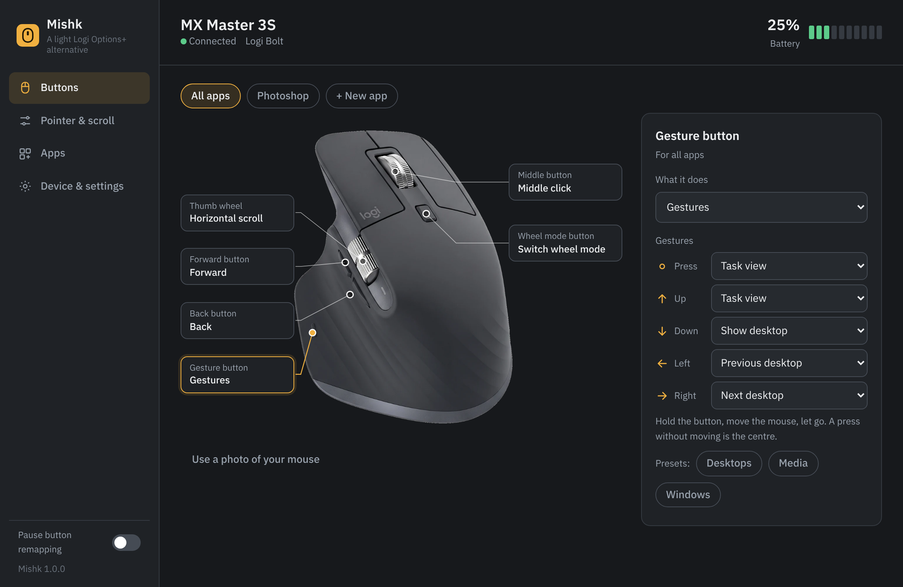
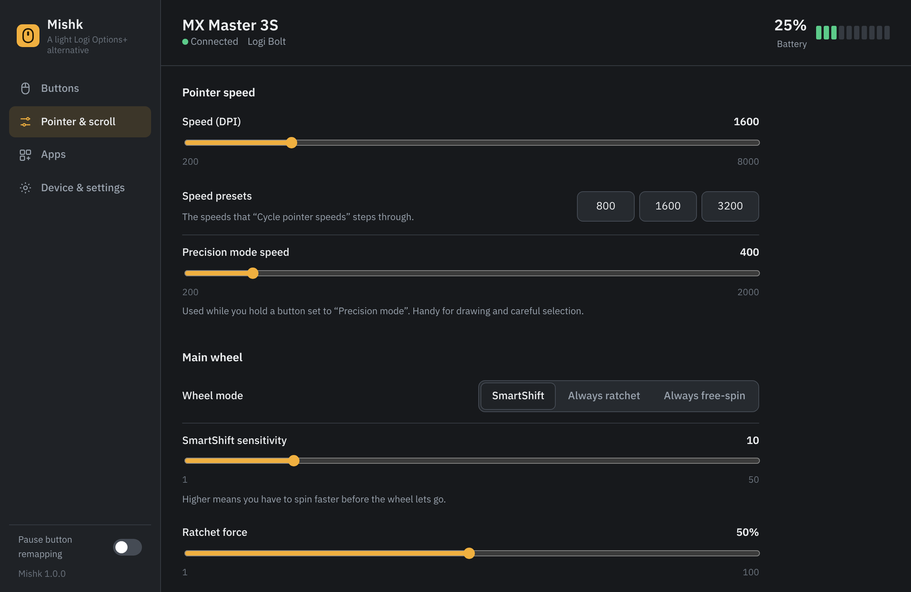
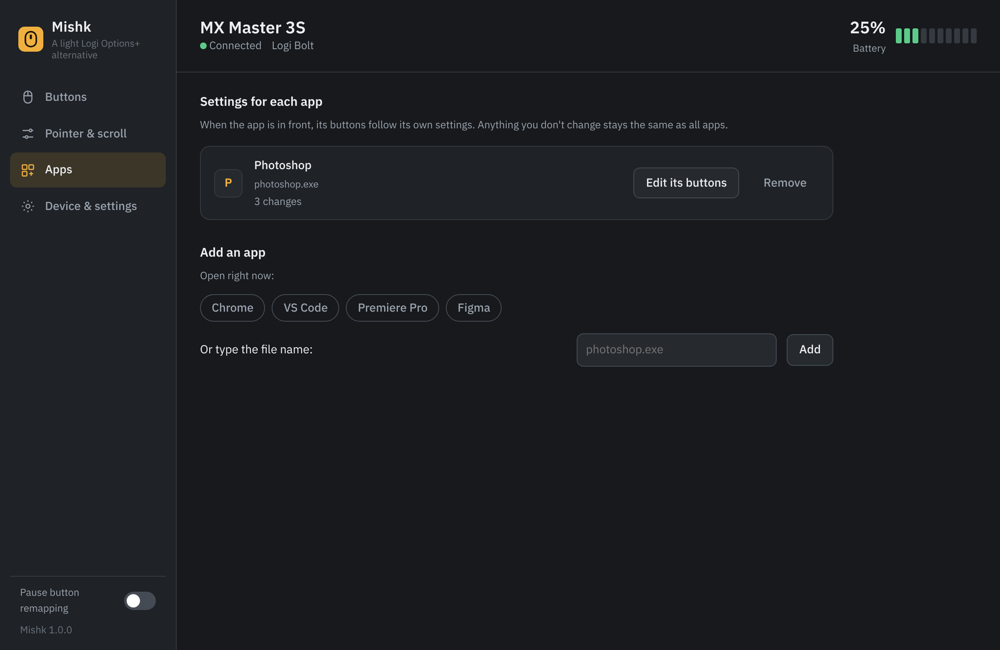
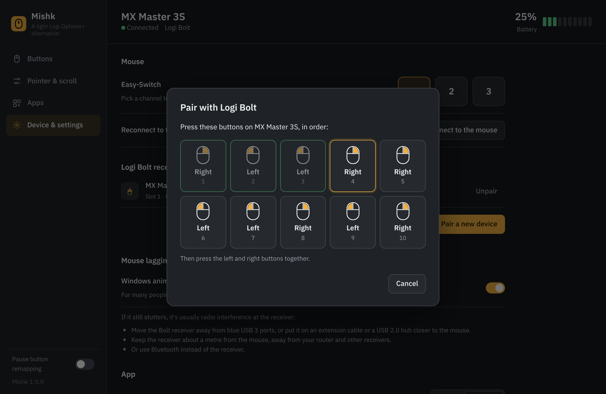

<div align="center">


# Mishk

**A small, fast replacement for Logi Options+ on Windows and macOS**

Made for the Logitech MX Master 3S, and works with most mice: other Logitech mice over HID++, and the back, forward and middle buttons of any mouse from any brand.

**Website:** [dlwjan11-dot.github.io/Mishk](https://dlwjan11-dot.github.io/Mishk/)

English · [العربية](README.ar.md)

[**Download for Windows**](https://github.com/dlwjan11-dot/Mishk/raw/main/download/Mishk-Windows.zip) · [**Download for Mac**](https://github.com/dlwjan11-dot/Mishk/raw/main/download/Mishk-macOS.zip)

</div>



## Why

Logi Options+ is heavy, crashes, and sometimes disappears from the tray. Mishk is a small app with no installer and no account, for Windows and Mac. It opens instantly, and when you close the window it drops back to the tray and frees its memory.

Mishk talks to the mouse directly over Logitech's HID++ protocol. Buttons are reported by the mouse itself, so there's no Windows mouse hook that can time out and leave your buttons dead.

## What it does

**Buttons**
- Remap the gesture, back, forward, middle and wheel-mode buttons
- Gesture button: a press, or a swipe up, down, left or right, each with its own action
- Over 60 actions: Windows (task view, desktops, snapping), editing, browser, media, mouse clicks, keyboard shortcuts, open an app or a link
- Hold-style shortcuts: the keys stay held while you hold the button, e.g. Space for Photoshop's Hand tool
- Precision mode: hold a button to slow the pointer down, let go to return to normal speed

**Per-app profiles**
- Different buttons and thumb wheel for each app (Photoshop, Premiere, Chrome…), switched automatically when the app is in front
- Pick from the apps open right now, or type the file name

**Thumb wheel**
- Horizontal scroll, zoom, brush size, volume, tabs, undo/redo, timeline arrows, desktops, or two custom shortcuts

**Pointer and scrolling**
- Pointer speed (DPI) with presets, and a button action to cycle through them
- SmartShift, always ratchet or always free-spin, sensitivity and ratchet force
- Smooth scrolling, reversed scroll for the main wheel and the thumb wheel

**Other mice**
- Other Logitech mice: MX Master 4 (sense panel as the gesture button), MX Master 2S, MX Anywhere, MX Vertical (DPI button) and other HID++ mice get the buttons they have, DPI and battery
- Any mouse from any brand: back, forward and middle buttons with gestures and per-app profiles, plus Windows pointer speed, acceleration and scroll lines

**Pairing and the device**
- First-time pairing with Logi Bolt and Unifying receivers, including the Bolt left/right click passkey, and unpairing
- Battery in the tray with a low battery alert
- Easy-Switch channels
- Settings are put back automatically when the mouse wakes up or reconnects
- A "Mouse lag?" helper: turn off Windows animation effects in one click (stops stutter for many people on Windows 11), plus receiver placement tips

**The app**
- Arabic and English interface, dark and light
- Use your own photo of the mouse: the background is removed and the dots are placed on the buttons automatically
- Starts with Windows, export and import settings, a log for troubleshooting

| Pointer & scroll | Apps | Pairing |
|---|---|---|
|  |  |  |

## Getting started

**Windows**


1. Quit Logi Options+, and turn off its startup. Both apps fight over the mouse. Mishk warns you if Options+ is running and can close it.
2. [Download Mishk-Windows.zip](https://github.com/dlwjan11-dot/Mishk/raw/main/download/Mishk-Windows.zip), right-click it and choose **Extract All**, then run `Mishk.exe`.
3. Windows SmartScreen may warn you because the app isn't signed: click **More info**, then **Run anyway**.

Mishk adds itself to the tray and starts with Windows. Settings are saved in `%APPDATA%\Mishk`.

Needs Windows 10 or 11 with the Microsoft Edge WebView2 Runtime (already part of Windows 11).

**Mac** (macOS 11 or newer, Apple Silicon and Intel)

1. Quit Logi Options+.
2. [Download Mishk-macOS.zip](https://github.com/dlwjan11-dot/Mishk/raw/main/download/Mishk-macOS.zip), unzip it and drag **Mishk** to Applications.
3. Open it. The Mac version isn't notarized by Apple yet, so the first time macOS blocks it: go to **System Settings → Privacy & Security**, scroll down and click **Open Anyway**.
4. Allow Mishk under **Privacy & Security → Accessibility**, so it can send shortcuts and remap other mice.

Mishk lives in the menu bar and opens at login. Settings are saved in `~/Library/Application Support/Mishk`.

## Limitations

- Windows: shortcuts don't reach apps running as Administrator unless Mishk runs as Administrator too.
- Mac: the Windows-only pointer speed, acceleration, scroll-line and animation settings aren't on the Mac version; use System Settings for those.
- Tested against a simulated MX Master 3S and Bolt receiver. Real-hardware reports are welcome: open **Device & settings → Show log** and attach it to an issue.

## Building

The Mac app is built and smoke-tested automatically on GitHub's macOS machines (see `.github/workflows/macos.yml`) and published to `download/`. For Windows you need Go 1.22+, Python 3 and mingw `windres`. Dependencies are vendored, so it builds offline:

```sh
./build.sh        # writes dist/Mishk.exe
go test ./...     # runs the protocol engine against a simulated MX Master 3S
```

## Credits

- HID++ details cross-checked against [Solaar](https://github.com/pwr-Solaar/Solaar) and [Mouser](https://github.com/TomBadash/Mouser) (MIT)
- Mouse image by Abdulrahman (Abdulmedia)
- [go-webview2](https://github.com/jchv/go-webview2) (MIT)
- IBM Plex Sans Arabic, SIL Open Font License ([res/FONT-LICENSE-OFL.txt](res/FONT-LICENSE-OFL.txt))

Not affiliated with Logitech. Logitech, Logi, MX Master and Logi Bolt are trademarks of Logitech.

## License

[MIT](LICENSE)
